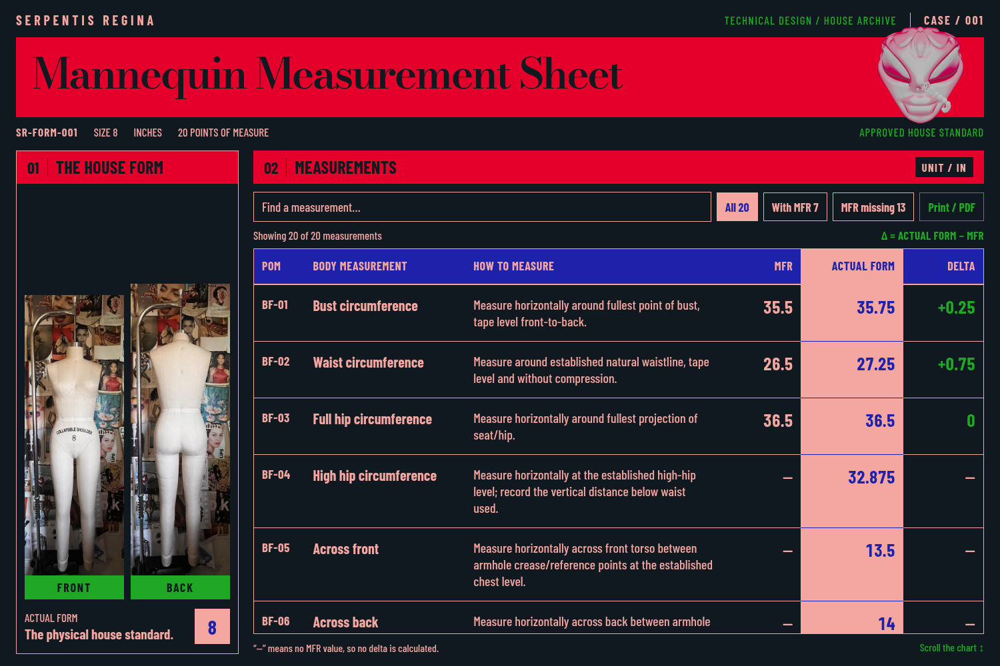

# Case 1 — brand redesign

This implements the founder's October 22, 2026 design comments on the existing
mannequin measurement report. The [original design](case-1-mannequin-review.md)
is preserved for comparison.

This is the earlier color layout. The founder's subsequent edits are in the
[latest layout refinement](case-1-layout-refinement.md).



[Phone preview](previews/case-1-brand-mobile.png)

## Design and behavior

- **Obsidian #101820** page; **Ruby #E4002B** title and section boxes.
- **Electric #1E22AA / Salmon #F4A6A0** chart headings and actual-form column,
  with **Slytheren #1FA824** accents. The UI uses only these five brand colors.
- Larger **Bodoni Moda** editorial title and **Barlow Condensed** labels,
  instructions, and numbers. The Notion Brand Bible requires sign-in in this
  connection, so this pairing is a proposal, not a verified Notion font choice.
- Original website head artwork in the upper-right seal, plus the original
  workbook's front/back mannequin photos. Supplied artwork retains its colors.
- A fixed upper page, photo panel, search, filters, and chart headings. The
  measurement region scrolls vertically and horizontally, including by keyboard.
- Six columns: **POM**, **Body measurement**, **How to measure**, **MFR**,
  **ACTUAL FORM**, **Delta**. Removed the reference-status column and repeated
  source labels from visible rows.
- Search, manufacturer filters, empty-search feedback, and Print / PDF.
  Printed pages expand the chart, repeat its heading, and include record notes
  and the explanation of missing values.

The shared palette is [design/brand-tokens.json](../design/brand-tokens.json).
The [brand system](brand-system.md) records the workbook color evidence and
the standing direction for future pages. See [asset provenance](../assets/house-sheet/README.md)
for the unchanged original images and locally bundled, licensed fonts.

## Run and review

With Node.js 24+, run:

```bash
npm run sheet
```

Open `reports/SR-FORM-001-measurement-sheet.html` in a browser. The generated
HTML includes all its fonts, images, styles, and scripts and makes no external
requests. It is a local browser report, separate from the Squarespace portal.
The same design is used by `npm run sheet:db`.

The 20 approved measurement records, original methods, and calculations are
unchanged. **Delta = ACTUAL FORM − MFR**, in inches. Missing MFR values and
their deltas remain absent, displayed as **—**.

## Validation

- All 48 existing application tests passed.
- JSON and SQLite report generation succeeded; a second baseline import was
  unchanged. Existing generator and client-intake artifacts remain reproducible.
- Browser checks cover desktop, laptop, two standard phone sizes, narrow/short
  phones, and landscape/tablet screens, with a usable chart at each size.
- Verified keyboard chart scrolling with stationary masthead/sticky headings,
  exact colors, all three images/fonts, search/filter behavior, missing values,
  and absence of external network requests or script/CSP errors.
- PDF text verification covers all 20 POMs, the approval/provenance caveat,
  the distinction from garment tolerances, and the missing-reference note.

[Browser evidence and screenshot hashes](validation/case-1-brand.json)

To repeat the browser checks with optional Python Playwright/pypdf packages and
`/usr/bin/chromium` installed:

```bash
python3 scripts/check-house-sheet-browser.py
```

By default, captures and a verification PDF go to `reports/browser-review/`.
Those are local generated files; only reviewed screenshots and their evidence
are committed under `docs/`.
