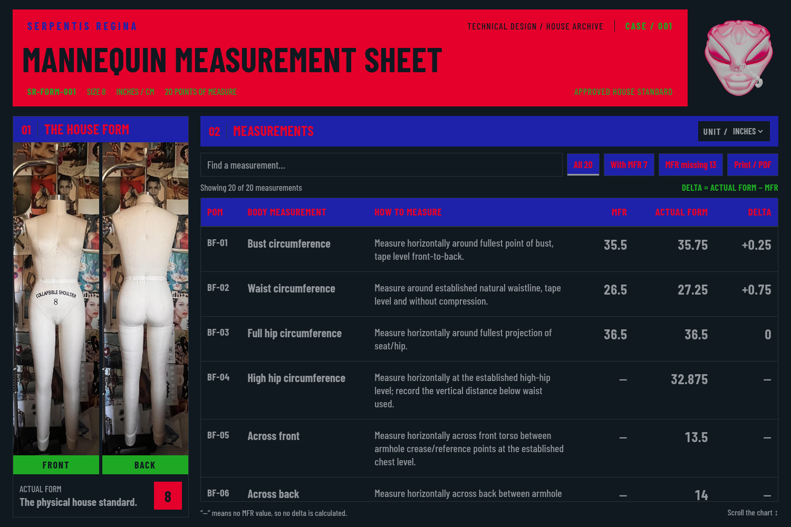

# Case 1 — metadata colors and centimeter display

[Desktop in CM](previews/case-1-centimeters-desktop-cm.png) ·
[Phone preview](previews/case-1-centimeters-mobile.png) ·
[Browser evidence](validation/case-1-centimeters.json)

## Requested visual edits

- **SERPENTIS REGINA** uses Electric text. **CASE / 001**, form ID, size,
  the static **INCHES / CM identity label**, 20-point count, approval label,
  and delta formula use Slytheren text. The separate dark UNIT selector keeps
  matte ash text for its selected value.
- The main title and division remain Obsidian on Ruby; metadata overlays
  remain transparent. Green is limited to the listed foregrounds and the
  original Front/Back caption fills.
- Every toolbar filter and Print button keeps Electric fill with Ruby text
  in all states. The chart body retains matte ash text and neutral outlines.

## UNIT selector

Choose **inches** or **centimeters** with the native UNIT dropdown (`in`/`cm`).
The report starts in inches. MFR, Actual Form, and deltas convert using
**1 in = 2.54 cm**, calculated from the canonical inch values on every switch.
Display uses up to six decimal places, trims trailing zeros, and preserves
signed deltas and missing-reference dashes.

For example, the waist's **27.25 − 26.5 = +0.75 in** displays as
**69.215 − 67.31 = +1.905 cm**. Switching back restores the inch display.
Print/PDF uses the currently selected unit.

All 20 approved source measurements, source labels, and original measuring
instructions remain unchanged. Inch landmarks written in those instructions
are preserved. The conversion changes display only; it does not revise the
approved register or introduce garment tolerances.

Run `npm run sheet` with Node.js 24+ and open
`reports/SR-FORM-001-measurement-sheet.html`. Existing layouts, original assets,
chart-only scrolling, and earlier screenshots/history remain preserved.
See the [brand system](brand-system.md) for current color rules.

## Verification

All 53 application tests and eight browser viewport checks passed. The browser
checks all 20 MFR/Actual Form/delta rows in both units, repeated round trips,
search/filter preservation, missing values, chart-only scrolling, current
colors, and a CM PDF containing all 20 POMs and record history.
