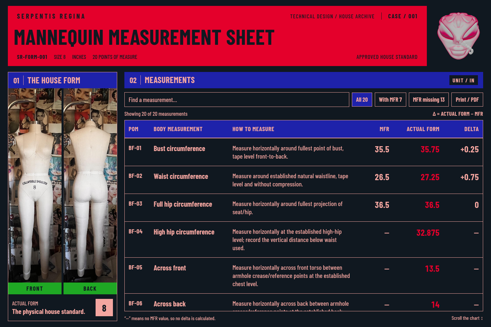

# Case 1 — historical house color review

**Superseded: use the [corrected Ruby rule](case-1-ruby-rule.md). Electric
Blue fills always use Ruby text, and Salmon/light pink is banned from current
UI styling.** This page preserves the earlier direction and its screenshots
as history; it is not implementation guidance.

[Phone preview](previews/case-1-house-colors-mobile.png) ·
[Browser evidence](validation/case-1-house-colors.json)

## Historical colors (superseded)

| Area | Fill | Text |
|---|---|---|
| Title box | Ruby `#E4002B` | Obsidian/black |
| Metadata inside title | Transparent over Ruby | Obsidian/black |
| Every Electric Blue box, including section/chart headings | Electric `#1E22AA` | Salmon `#F4A6A0` |
| Front and Back captions only | Slytheren `#1FA824` | Obsidian `#101820` |
| Chart and controls | Obsidian | Salmon; Actual Form numbers remain Ruby |

The earlier review requested Salmon text on Electric fills. That instruction
is superseded by Ruby text on Electric and the ban on Salmon UI. Green remains
limited to the two caption backgrounds, and metadata remains directly over
Ruby without dark boxes.

## Keep the approved layout and measurements

Barlow Condensed type, the standalone original head seal, aligned front/back
photo frames, six columns, fixed upper layout, and chart-only scrolling stay
in place. Original artwork and photographs retain their pixels and colors.
The 20 approved POMs, exact methods, missing references, and
**Delta = ACTUAL FORM − MFR** calculation are unchanged.

Run `npm run sheet` with Node.js 24+ and open
`reports/SR-FORM-001-measurement-sheet.html`. This embedded, standalone report
is separate from the live Squarespace portal. The shared
[brand system](brand-system.md) and
[tokens](../design/brand-tokens.json) document the current direction.
