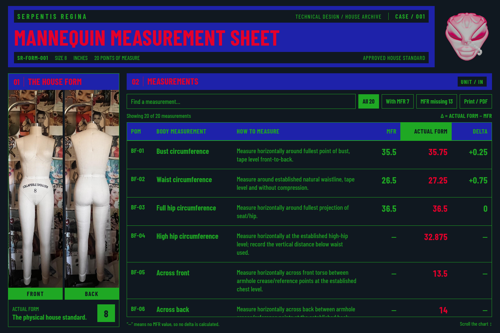

# Case 1 — layout refinement

Historical review: the layout remains relevant, but its color instructions
are superseded by the [current house color rule](case-1-house-colors.md),
including Salmon text on every Electric Blue fill and green restricted to
the Front/Back caption backgrounds.

This applies the founder's next design comments to the
[previous brand layout](case-1-brand-redesign.md).



[Phone preview](previews/case-1-refined-mobile.png)

## Changes

- **Barlow Condensed 700** for the uppercase title, matching the chart font.
- The original Syren head stands alone on Obsidian beside the title area.
  Brand, case, form, units, and approval metadata are all inside the title
  area. The existing green metadata stays green; earlier Salmon text is
  replaced because the founder removed light pink from the sheet.
- **Electric Blue fills and Ruby lettering** for the title and both section
  boxes. The chart and controls use Slytheren/Obsidian, with Ruby actual-form
  numbers. Salmon is excluded from this sheet's theme.
- Original front/back photos fill equal-height frames with matched top and
  bottom edges using CSS cover. Source image files are unchanged; display
  cropping adapts to the available frame.
- Fixed upper layout, chart-only scrolling, search/filters, six columns,
  original measurement methods, and full PDF printing remain available.

The light-pink removal applies to the interface. The founder's original
sculpted head artwork and photographs retain their original pixels/colors.

## Run and review

With Node.js 24+, run `npm run sheet` and open
`reports/SR-FORM-001-measurement-sheet.html` in a browser. It is a standalone
local report with embedded assets, separate from the live Squarespace portal.
The approved 20-POM data and **Delta = ACTUAL FORM − MFR** rule are unchanged.

`npm test` runs the existing 48 application checks. The browser regression
checks the new title/seal arrangement, aligned image frames, removal of
Salmon UI colors, eight viewport sizes, scrolling, search/filters, and PDF
content. See [browser evidence](validation/case-1-refined.json).

With optional Python Playwright/pypdf packages and Chromium available, repeat
the browser review with:

```bash
python3 scripts/check-house-sheet-browser.py
```

The previous screenshots remain under their original names in `docs/previews/`.
See the [brand system](brand-system.md) for source colors and standing guidance.
