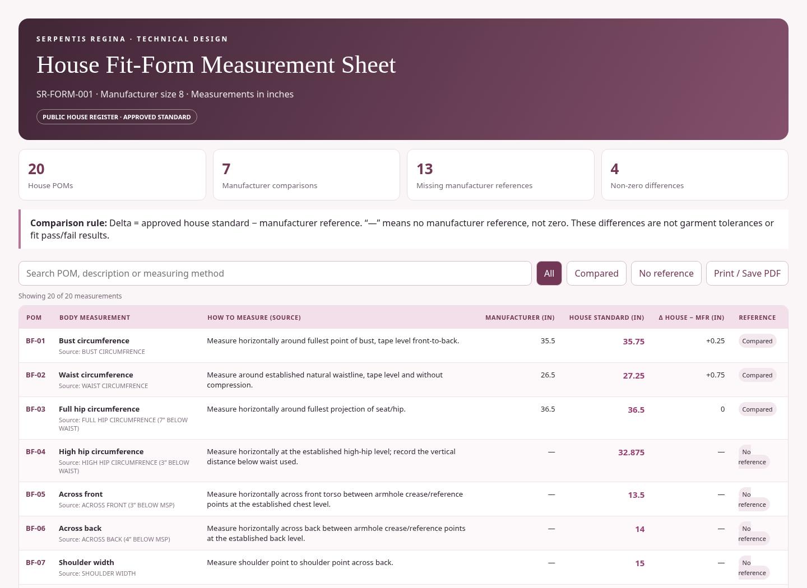

# Case 1 — mannequin measurement sheet: current design

The founder selected the mannequin-versus-manufacturer sheet as Case 1 for a
page-by-page tech pack coding project on October 22, 2026. These screenshots
preserve the existing browser design before the founder supplies design comments.

## Review the current screen

[Open the full sheet screenshot](previews/case-1-mannequin-current-full.png).

These are actual Chromium screenshots of the unmodified report generated by
`npm run sheet` from source commit
`c0f0c8eda017e0c702d137a1ff02c31c920094f1`. They show the existing offline/browser
report, not a measurement page published on the live Squarespace website.

The current design has a plum heading, blush background, four summary cards,
search, reference filters, a measurement table, and Print / Save PDF. Its
**Manufacturer** column corresponds to the workbook's **MFR SIZE 8**; its
**House standard** column corresponds to the workbook's **ACTUAL FORM**.

## Founder-supplied source workbook

[TECH PACK TEMPLATE — SERPENTIS REGINA — V.002 / V2](https://docs.google.com/spreadsheets/d/1ALn9OogQy6x4YSEohhlew-NaIdeEdm2F/edit?gid=1422941812#gid=1422941812)

The linked workbook was readable and exported as XLSX on October 22, 2026.
Its SHA-256 is
`2fc52c4d87a69dd064b01126a2ada6b90a816deecc212a13f16fc0ac6bb38b33`,
identical to the copy downloaded during the previous source audit. The original
workbook is kept outside this public checkout.

The workbook's `BODY REF-MANNEQUIN-SIZE 8-V1` tab matches all 20 BF POMs in the
existing approved GitHub register: manufacturer references, actual mannequin
values, original source labels, and measurement instructions. There are no
discrepancies. The exported XLSX does not expose the Google `gid` mapping, so
this comparison identifies the tab by its name and contents.

The linked workbook is an additional source container for the same mannequin
records. The existing approved JSON retains its original provenance URL and
approval record. The workbook's earlier pending-verification wording and the
versioned register's later approval remain distinct.

## Current comparison behavior

**Delta = ACTUAL FORM − MFR**, in inches. The existing code calculates these
deltas; the workbook's mannequin delta cells are blank in the exported source.

| Measurement | ACTUAL FORM | MFR | Calculated delta |
|---|---:|---:|---:|
| Bust | 35.75 | 35.5 | +0.25 |
| Waist | 27.25 | 26.5 | +0.75 |
| Full hip | 36.5 | 36.5 | 0 |
| Front neck to waist | 14.25 | 14.5 | -0.25 |
| Back neck to waist | 16.5 | 16.5 | 0 |
| Bust point to bust point | 7 | 7 | 0 |
| Neck | 15 | 13.5 | +1.5 |

The sheet contains 20 POMs, 7 available manufacturer comparisons, 13 absent
references, and 4 nonzero deltas. Missing references and their deltas display
**—**. These comparisons do not define garment tolerances, ease, or fit approval.

## Tech pack pages identified in the workbook

1. `PATTERN CARD`
2. `BW-AW-SPEC`
3. `FIT & COM`
4. `GRADED SPECS`
5. `00-MEASUREMENT SHEET MASTER`
6. `BODY REF-MANNEQUIN-SIZE 8-V1` — the selected Case 1 starting point

This review captures the existing mannequin page. The other workbook pages
are identified here for the subsequent page-by-page work.

## Verification

- `npm test`: 48 tests passed, 0 failed.
- `npm run sheet`: generated the existing report successfully.
- Chromium: verified all 20 rows, search for BF-02 and its +0.75 delta,
  all/reference/missing filters, and no page script errors.
- [Capture details and screenshot hashes](validation/case-1-mannequin-current.json).

The report generator, approved measurements, and calculation logic have not
been redesigned in this review. The screenshots are the starting point for
the founder's visual and workflow comments.
