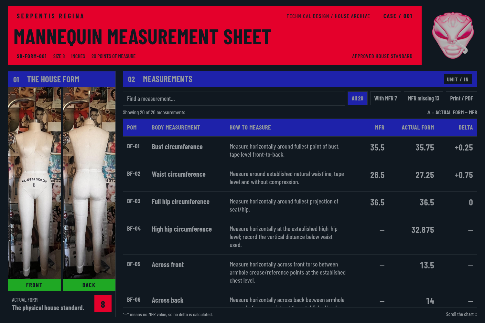

# Case 1 — earlier matte ink refinement

The [current scoped Ruby review](case-1-scoped-ruby.md) restores Ruby text
inside Electric Blue fills. This page records the earlier matte-header
appearance; matte ash lettering outside blue and neutral outlines remain.

The founder requested matte black lettering that stands out from the dark
background, with red outlines removed.

[Phone preview](previews/case-1-matte-ink-mobile.png) ·
[Browser evidence](validation/case-1-matte-ink.json)

- Previously Ruby lettering now uses **ash charcoal `#92989D`** on the
  Obsidian page and Electric headers, including chart values and controls.
- Former red outlines use **neutral `#293239`**. Selected text spans have
  a subtle, embedded SVG grain for the matte treatment.
- The main Ruby title fill retains Obsidian text and transparent metadata
  overlays. Green remains limited to the Front/Back caption backgrounds.
- Original artwork and photos retain their pixels and colors. Salmon remains
  excluded from interface styling.

This is an explicit **Case 1 exception** to the general Electric-fill/Ruby-text
house standard. It does not change that global default. See the
[brand system](brand-system.md) and the
[earlier Ruby-text layout](case-1-ruby-rule.md).

The Barlow Condensed type, standalone seal, aligned photo frames, six columns,
fixed upper area, and chart-only scrolling are preserved. All 20 approved
measurements, source methods, missing references, and
**Delta = ACTUAL FORM − MFR** remain unchanged.

Run `npm run sheet` with Node.js 24+ and open
`reports/SR-FORM-001-measurement-sheet.html`. Fonts, images, and the grain are
embedded locally in the standalone report; it remains separate from the live
Squarespace portal.
