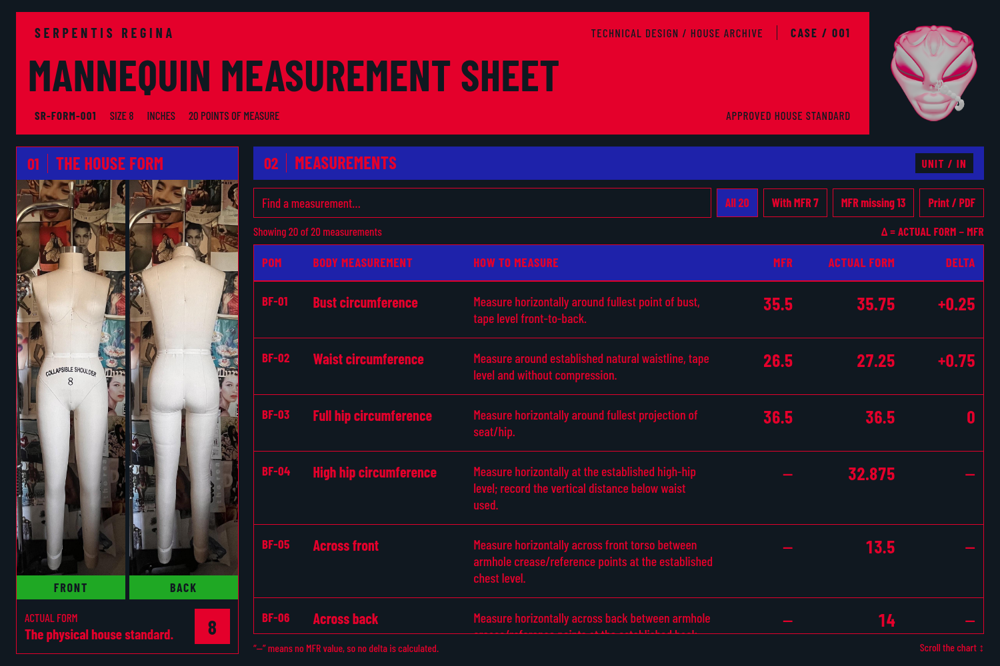

# Case 1 — earlier Ruby-text layout

This preserves an earlier Case 1 appearance. The founder's
[matte ink refinement](case-1-matte-ink.md) now governs this report's lettering
and outlines. The general Electric-fill/Ruby-text house standard remains in
place for other surfaces, with the current mannequin report as an exception.

**Electric Blue fills always use Ruby text. No Salmon/light pink UI.**
This corrected house rule supersedes the
[previous pink-text direction](case-1-house-colors.md).

[Phone preview](previews/case-1-ruby-rule-mobile.png) ·
[Browser evidence](validation/case-1-ruby-rule.json)

| Area | Fill | Text |
|---|---|---|
| Title and transparent metadata overlay | Ruby `#E4002B` | Obsidian `#101820` |
| Every blue box, including section/chart headings | Electric `#1E22AA` | Ruby `#E4002B` |
| Front/Back captions only | Slytheren `#1FA824` | Obsidian |
| Chart, controls, deltas, and supporting details | Obsidian | Ruby |

Green is limited to the two photo-caption backgrounds. Salmon is retained
only in raw source-palette history; it is not an active UI color. Original
artwork and photographs remain unchanged.

The layout, Barlow Condensed type, isolated original seal, aligned photos,
six columns, fixed upper area, and chart-only scrolling are preserved.
All 20 approved measurements, source methods, missing references, and
**Delta = ACTUAL FORM − MFR** remain unchanged.

Run `npm run sheet` with Node.js 24+ and open
`reports/SR-FORM-001-measurement-sheet.html`. The standalone report remains
separate from the live Squarespace portal. See the
[brand system](brand-system.md) for the standing rule.
