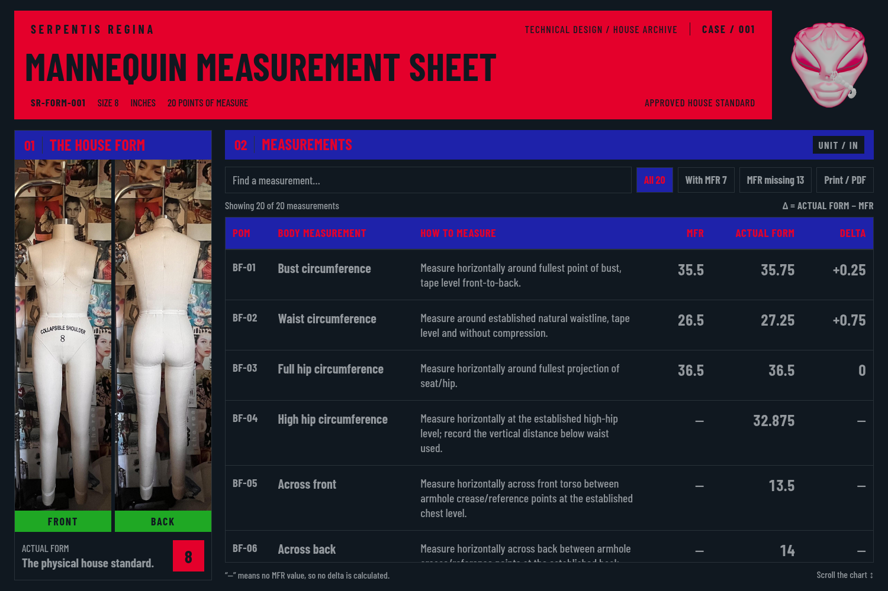

# Case 1 — Ruby text inside blue fills

The founder clarified the scope: **Electric Blue fill requires Ruby text**.
Lettering outside blue-filled regions keeps its existing matte ash treatment.

[Phone preview](previews/case-1-scoped-ruby-mobile.png) ·
[Browser evidence](validation/case-1-scoped-ruby.json)

- Section headers and chart headings use Electric `#1E22AA` fill with Ruby
  `#E4002B` text.
- Selected or hovered buttons use Ruby text when their fill is Electric.
- Body measurements, methods, numbers, deltas, and controls outside blue
  retain ash charcoal `#92989D` and the existing matte grain.
- Outlines remain neutral `#293239`; there are no red outlines. The Ruby
  title keeps Obsidian text and transparent metadata overlays. Green remains
  limited to the Front/Back caption backgrounds; Salmon remains excluded.

The general Electric/Ruby house rule now applies to Case 1 too. The
[earlier matte ink review](case-1-matte-ink.md) preserves the previous header
treatment. Original assets, layout, fonts, chart scrolling, all 20 approved
measurements, source methods, and **Delta = ACTUAL FORM − MFR** are unchanged.

Run `npm run sheet` with Node.js 24+ and open
`reports/SR-FORM-001-measurement-sheet.html`. See the
[brand system](brand-system.md) for the current standing rules.
