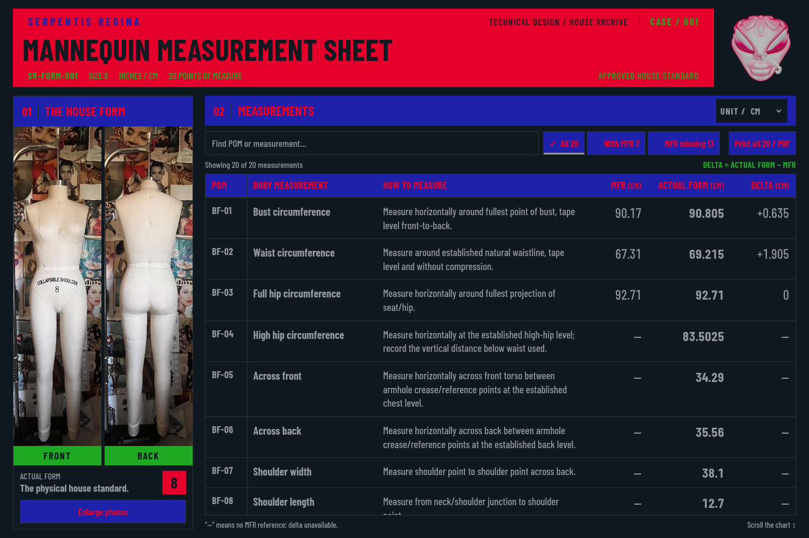

# Case 1 — workroom refinement

The mannequin reference sheet is designed for fashion technical designers,
pattern makers, and seamstresses. This revision improves comparison, reference
inspection, and working printouts while preserving every existing house color
and color assignment.



[Phone view](previews/case-1-workroom-mobile.png) ·
[Phone comparison view](previews/case-1-workroom-mobile-values.png) ·
[Original photograph viewer](previews/case-1-workroom-photo-dialog.png) ·
[Browser evidence](validation/case-1-workroom.json)

## Working with the sheet

1. Search by BF POM code, body measurement, or words from a measuring method.
   Filter to all 20 POMs, the seven with MFR references, or the 13 without them.
   A checkmark identifies the selected filter. If no rows match, use **Clear
   search and show all** to reset both search and filter.
2. Choose **INCHES** or **CM**. The numeric headings repeat the selected unit;
   Actual Form uses stronger type than MFR and Delta. All original measuring
   methods, including fixed inch landmarks, remain as written.
3. Scroll the chart to continue reading. Headings and POM identifiers stay
   visible. Narrow screens retain all six columns with horizontal scrolling
   and a visible swipe cue. The upper page remains fixed.
4. Use **Enlarge photos** to inspect both original photographs in full. The
   viewer supports keyboard navigation, **Close photos**, and Escape; closing
   returns focus to the opening control. The original source pixels and colors
   are unchanged.
5. Use **Print all 20 / PDF**, or the browser's print command, for the complete
   reference sheet in the selected unit. Search and filters do not remove POMs
   from the printout. Record notes are included, and the screen's query, filter,
   note expansion, and chart position are restored after printing.

## Preserved standards

- Approved SR-FORM-001 v1: manufacturer-designated size 8, 20 BF POMs in
  canonical inches, seven MFR references and 13 missing references.
- Delta remains **Actual Form − MFR**, with signed values and missing-reference
  dashes. These comparisons are not garment specifications, ease, grading,
  manufacturing tolerances, or fit pass/fail decisions.
- IN/CM conversion always starts from canonical inches using exactly 2.54,
  with up to six decimal places and no cumulative rounding.
- Every existing color token, color assignment, original photograph, sculpted
  head seal, Barlow font, and matte-grain asset is preserved. No palette or
  contrast changes are part of this revision.
- The existing portal, client intake, measurement-session generator, approved
  data, source methods, and approval history remain separate and unchanged.

## Build and verification

With Node.js 24+:

```bash
npm test
npm run sheet
python3 scripts/check-workroom-sheet-browser.py
```

Open the generated `reports/SR-FORM-001-measurement-sheet.html`. It embeds its
fonts, original images, styles, and scripts and runs without external requests.
Generated reports remain Git-ignored. This is a standalone browser report;
it is not deployed to Squarespace and does not synchronize with Google Sheets.

The workroom browser checker verifies original source bytes and colors,
measurement values in both units, repeated switches, fixed headings and POM
identifiers, search/filter recovery, the photograph viewer, and full PDF output
from filtered and empty states. It includes nine viewport sizes; 750 × 500 CSS
pixels is a reduced-layout check and does not claim an actual browser zoom or
screen-reader audit. The earlier centimeter review and screenshots remain in
history.
