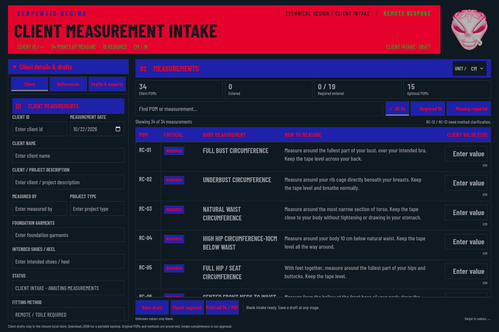

# Client measurement intake — workroom edition

The client intake now shares the mannequin sheet's visual system: Obsidian
background, Ruby title with black text, Electric headings/buttons with Ruby
text, green title metadata, ash chart text, neutral borders, Barlow Condensed,
and the original isolated head seal. The same exact active house colors are
used throughout, including validation and saved-draft states.



[Blank phone view](previews/case-2-client-intake-standalone-mobile.png) ·
[Phone value-entry view](previews/case-2-client-intake-standalone-mobile-values.png) ·
[Reference notes](previews/case-2-client-intake-standalone-references.png) ·
[Drafts and exports](previews/case-2-client-intake-standalone-drafts.png) ·
[Browser evidence](validation/case-2-client-intake-workroom.json)

## Technical workroom workflow

The audience is fashion technical designers, pattern makers, and seamstresses.
Client details, measuring methods, active units, required measurements, original
references, and complete working printouts take priority.

- Use **Client**, **References**, and **Drafts & exports** to move between the
  original metadata, separate-file reference notes, and saved records.
- Search by RC POM code, measurement, or method. Filter to **All 34**,
  **Required 19**, or **Missing required**. The active filter has a checkmark.
- POM codes and table headings stay visible during chart scrolling. All five
  original client columns are retained. Phones open the context panel for
  editing and close it to return to the chart; Save, Check, and Print remain
  available while editing.
- Enter decimal values and use Tab to continue. A row being entered stays in
  the Missing required view until its input loses focus. Unknown values remain
  blank; explicit zero remains zero.
- Check required reveals the relevant client field or missing measurement.
  Invalid input takes priority over completeness gaps. Completing required
  values does not approve the intake or resolve source-method questions.
- Print includes all 34 POMs, client metadata, both reference-note areas, and
  the original source notes in the selected unit, regardless of search/filter
  state. The working screen is restored afterward.

## Preserved source and storage rules

The sanitized workbook template is unchanged: 34 RC POMs, 19 required,
RC-21 absent, original labels/methods/landmarks, and RC-12/RC-13 questions.
Historical palette values and source-cell provenance remain in the controlled
JSON; the current interface uses the shared house tokens instead.

Canonical measurements remain centimeters, with CM/IN display conversion from
the original stored values, up to six decimals, and no cumulative rounding.
There is no MFR/Delta comparison or automatic house-form population in this
client intake. The mannequin sheet and approved house records are unchanged.

Each save creates a separate local draft. Standalone browser records and the
client-intake SQLite database remain separate. JSON/CSV export and compatible
JSON import are preserved. The ready-to-open HTML includes only the blank
template and original public brand assets; it contains no saved client records.
No remote submission, file attachment, spreadsheet synchronization, or live-site
deployment has been added.

## Build and review

```bash
npm run intake:build
npm test
python3 scripts/check-client-intake-workroom-browser.py
```

Open `client-intake.html` after extracting the source ZIP. For the separate
local SQLite application, use `npm run intake` with Node.js 24+.

The browser checker covers both the standalone and temporary SQLite runtimes,
nine viewport sizes, original-source fingerprints, fonts/seal/colors,
keyboard/context navigation, canonical values, missing/zero/invalid values,
search/required filters, saved-draft history, JSON/CSV import/export, unavailable
browser storage, and full selected-unit printouts with screen-state restoration.
Public captures show blank forms only. Synthetic filled printouts remain in
memory; temporary test downloads and databases are discarded. Reduced-layout
coverage does not claim an actual browser zoom or screen-reader audit.
