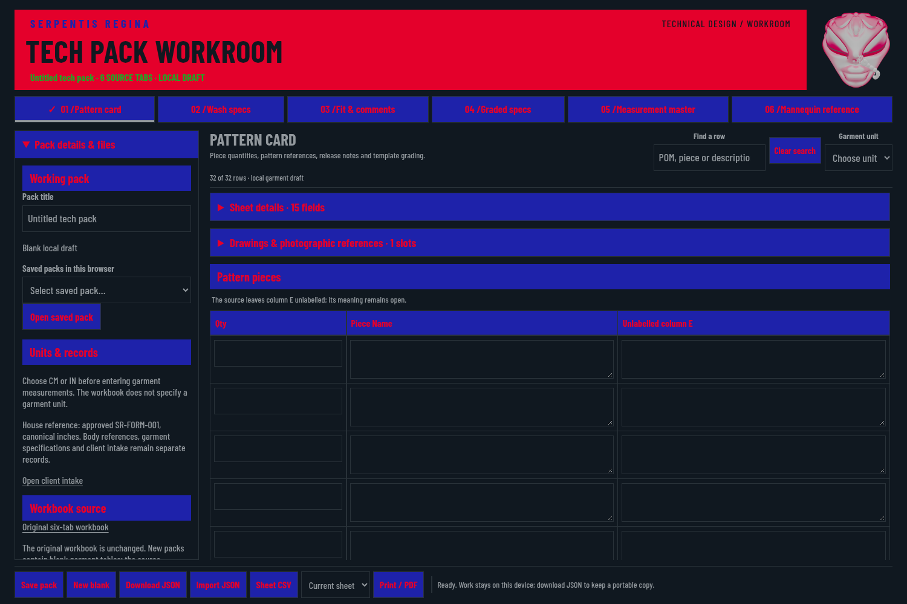
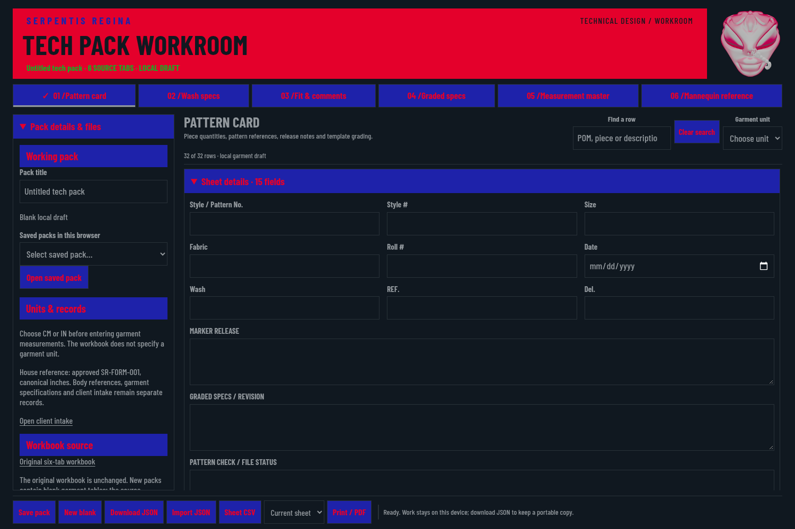
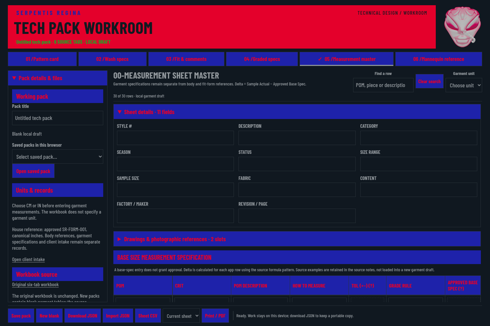
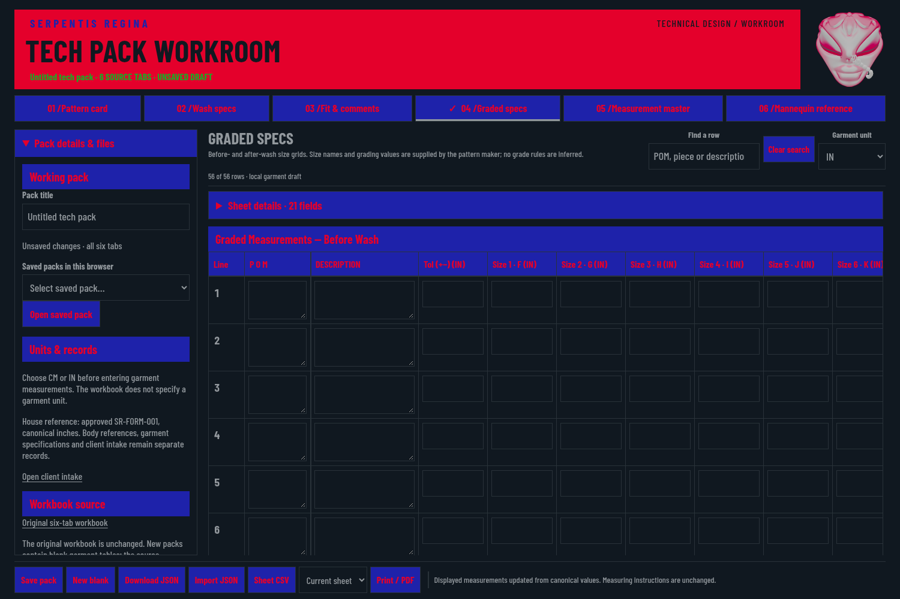
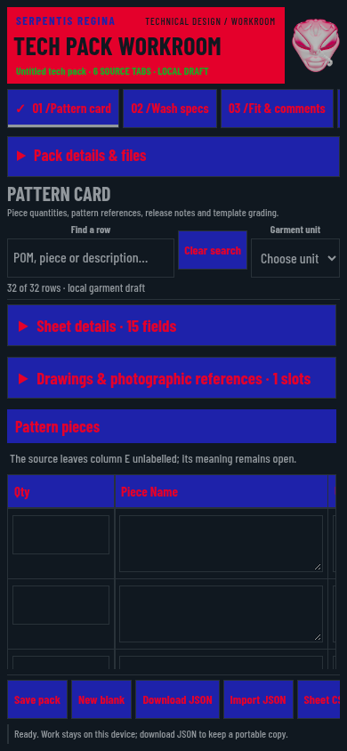
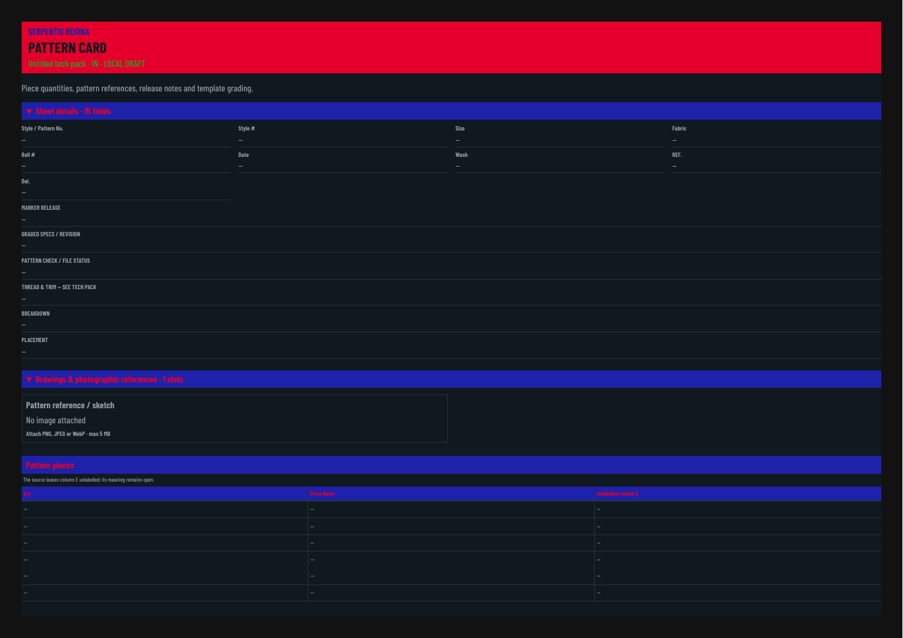

# Serpentis Regina — Small-studio usability and tech-pack roadmap

Reviewed October 22, 2026 against app commit `a9a3e597d89f8e3bfefc401400c8f2571fbc1ecc`. This is a proposed next-version roadmap grounded in a fresh local Chromium walkthrough and a read-only code review. The app already preserves the original six worksheet tabs and approved reference data; it needs a shared garment-development workflow and more complete production instructions to serve a small studio well.

Audience: independent fashion designers, technical designers, pattern makers and seamstresses. Keep the existing colors, assignments, Barlow Condensed, seal and original artwork. Keep approved BF body/form references, RC client records and garment POMs distinct.

## Current flow and evidence

All screenshots below were captured and inspected in this audit. They show blank house templates. Runtime probes used temporary synthetic entries only; no user projects, exports or filled PDFs are published. [Machine-readable observations](audits/tech-pack-usability/observations.json) record the checks.

| Step | Task | Current health | What to change |
|---|---|---|---|
| 1 | Start a style | Functional, needs guidance | Replace the blank-grid starting point with a short style setup and a clear next task. |
| 2 | Enter pattern/style details | Functional, repetitive | Collect shared style number, description, units, fabric references and sample size once. |
| 3 | Enter garment specs | Accurate decimal core, slow entry | Reuse garment POM definitions, allow fractional inches and spreadsheet paste, attach clear measurement diagrams. |
| 4 | Grade sizes | Functional fixed grid, rigid | Use only the actual size run, named sizes, optional interval-specific rules and a clear base size. |
| 5 | Save or export on a phone | Functional, recovery/discoverability gaps | Autosave, recover revisions, and keep primary Save/Export actions visible. |
| 6 | Print a maker handoff | Complete source print, limited production formatting | Add an export preview, maker/internal sections, paper choices, revision/page identity and an explicit option to omit unused rows. |

### 1. Start a style

The consistent palette, original seal, six direct tabs and explicit unit selector are strengths. A new user starts in a long piece list without a clear sequence. Metadata and source explanations occupy substantial space while the actual next decision is unclear.

Proposed start: **Style → Materials & construction → Pattern/specifications → Fitting → Maker handoff**. Keep direct tab access for experienced users. A short setup asks for style number/name, garment category, units, sample size and relevant size range. Offer reusable studio templates and a last-edited style list. Bespoke work should be able to mark size-run grading not applicable; small-batch styles can enable the appropriate size grid. Template suggestions remain drafts supplied or reviewed by the designer.

### 2. Enter pattern/style details

The Pattern Card has 15 metadata fields, while the master later asks for overlapping style, fabric, description and sample information. A runtime probe confirmed that changing Pattern Card style does not populate the master. Only the Fit & Comments style is currently linked.

Create one shared style record and explicit overrides for particular sample rounds or wash stages. Changes should propagate to relevant headings and documents without rewriting historical releases. Move original-source provenance into a quiet reference area; translate abbreviations such as POM and CRIT into brief contextual help.

Code basis: [fieldValue and field rendering](../workbook-web/app.mjs#L37), [per-sheet field maps](../src/tech-pack.mjs#L67).

### 3. Enter garment specifications

The existing canonical conversion, distinct delta formulas, missing-value handling and preservation of source methods should remain. Decimal-only parsing rejected `24 3/8` in the current audit. The current schema fixes all row IDs and requires them exactly on import, so adding rows requires a model change and migration.

Add a central **garment** POM library: stable code, label, measuring method, linked diagram, critical flag and measurement context. A flat half-chest width and a body chest circumference must stay different concepts. Add relaxed/stretched and before/after-wash context where the garment needs it. Reuse the definition across spec, wash, fit and graded views while keeping each stage's values separate.

Provide fractional-inch entry, copy/paste rectangular spreadsheet ranges, Tab/Enter navigation, add/duplicate/reorder rows, undo, and configurable display precision. Changing display precision must preserve canonical values. Show errors beside the actual cell and clear stale error messages after correction. Pair diagrams and tables in an optional split view.

Code basis: [table rendering](../workbook-web/app.mjs#L50), [decimal parser](../src/tech-pack.mjs#L146), [strict row validation](../src/tech-pack.mjs#L101).

### 4. Grade the actual size run

The grade grid has 11 size slots before wash and 11 after wash, with 28 rows per stage. One grid measured 1730 px across inside 1123 px of visible chart area at 1500 × 1000. Sticky POMs help, but all users must work around the source's fixed width and blank slots.

Let the pattern maker choose actual sizes and base size. Offer manual grading and reviewed rules per POM and size interval. Preview calculated size values, highlight overridden cells, and preserve rule versions. Support asymmetric plus/minus garment tolerances. Comparison flags need a stated measurement context and chosen tolerance; they are never inferred from mannequin differences. Do not apply one generic grade increment to every garment or assume body measurements are finished specs.

### 5. Save, recover and work on a phone

The phone layout keeps useful content on screen, but the action strip measured 585 px inside 374 px of visible space. Sheet CSV, print scope and Print/PDF sit off screen. Make one visible Export action open a clearly labelled menu; keep Save status and the primary action visible.

Current Save stores the latest pack and replaces the prior entry with the same ID. Two saves left one stored record. It is not revision history. Images are embedded base64 inside a synchronous localStorage array. One incompatible stored record currently causes the entire saved list to disappear from view, although the stored bytes still exist.

Move drafts and original image blobs to IndexedDB. Autosave after valid edits, show an accurate saved timestamp, retain recoverable drafts, offer undo/restore, and keep deliberate named revision snapshots. Preserve JSON backups. Load valid stored records individually and offer recovery for incompatible entries. Add schema migrations so existing packs survive new features. Browser autosave remains device-local; it does not imply cross-device synchronization.

Code basis: [saved-list loading](../workbook-web/app.mjs#L9), [savePack](../workbook-web/app.mjs#L107), [image embedding](../workbook-web/app.mjs#L159).

### 6. Prepare a maker handoff

The current full blank pack produced 12 A3 landscape pages and contained all six source tabs. That preserves a complete working printout, but a maker needs a purposeful production package. The current choices are only current sheet or all sheets; every sheet is labelled LOCAL DRAFT.

Add an export preview with internal-working and maker-handoff presets. Include style number, revision, issue date and page identity on every page. Support Letter/A4 where appropriate and split wide graded tables into readable sections. Keep **Print complete worksheet** available. An explicit handoff option can omit unused rows, irrelevant sections and internal body/client references; do not silently hide populated specifications or required instructions. Internal costing visibility must be chosen deliberately.

A release should freeze a reviewed snapshot with a named person, date and production stage. Preserve earlier releases and show what changed. A completeness check can identify missing instructions; it cannot approve the design or settle unresolved source formulas.

Code basis: [buildPrint](../workbook-web/app.mjs#L123), [A3 print rules](../workbook-web/app.css#L241).

## Production content to add

The source workbook is strongest on measurements and pattern/fitting records. Professional tech packs commonly also carry technical flats, materials, construction instructions, measurement/grade specifications and revision history. [Techpacker's practitioner guide](https://techpacker.com/blog/design/what-is-a-tech-pack/) describes that broader content. Treat this as a practical completeness framework; the exact handoff must match the garment, maker and development stage.

1. **Bill of materials:** fabric, lining, interfacing, thread, closures, hardware, labels and packaging as applicable. Record supplier/article reference, composition, weight, usable width, color reference, quantity/consumption unit and selected costing information. Keep material colors as product specifications; they do not change the interface palette.
2. **Construction instructions:** linked front/back/detail callouts, seam allowance, seam/stitch type, stitch density, stitch length where relevant, hem/finish, reinforcement and assembly instructions. House-approved standard details can be reused, then overridden intentionally. Formal stitch/seam references can use the applicable [ASTM D6193 terminology](https://store.astm.org/d6193-16r25.html); naming a reference is not certification of a garment.
3. **Pattern and cutting details:** pieces with quantities, mirrored/pair instructions, self/lining/interfacing, grain/stretch direction, seam/hem allowance, notches, pattern-file revision and useful scale references. Give these explicit fields instead of assigning a meaning to the original unlabeled column E.
4. **Colorways, artwork and labels:** component-to-color mapping, artwork files/versions, placement dimensions and reference points, label sizes and positions. Do not treat an on-screen color swatch as a verified physical color match.
5. **Fitting rounds:** sample ID, date, pattern revision, measurements, photos with linked issues, requested correction, owner and recorded decision. Compare rounds rather than overwrite the prior comments. Preserve original sample values when a target spec changes.
6. **Reusable studio library:** garment POM sets, blocks, construction details and materials the designer has actually saved. Duplicate a style into a new identity, retaining useful specifications while clearing approvals, fitting outcomes and release signatures.

## Code changes in a practical order

| Release | Scope | Acceptance examples |
|---|---|---|
| A — Daily usability | Shared style setup, autosave/recovery, visible mobile export, inline errors, fractional input and undo | Enter a style number once and see it everywhere relevant; reload and recover valid edits; restore yesterday's named version; enter `24 3/8` IN as 61.9125 canonical CM; old packs still open. |
| B — Professional specification model | Central garment POM definitions, dynamic rows/sizes, spreadsheet paste, reviewed grading/tolerances and linked diagrams | One POM method updates relevant current views; before/after-wash values remain distinct; bespoke styles can omit grading; a paste preview rejects malformed cells without partial data loss. |
| C — Complete production handoff | BOM/construction/colorways, structured fittings, released snapshots, document preview and maker/internal export presets | Trace a photo issue to a correction and pattern revision; print the exact reviewed release with consistent page identity; internal client data is excluded by deliberate export scope. |

Keep the offline app. Use separate modules for garment data/calculations, persistence/migrations, grid editing, images, fittings and document export; retain a small coordinating UI layer. Test workflow outcomes and migration/recovery paths, rather than adding tests that merely mirror rendering code. Defer hosted multiuser systems until the day-to-day local workflow is stable.

## Readability and evidence limits

Larger labels and values, calmer spacing, fewer repeated all-caps explanations, clear focus, visible selected states and better error placement can improve readability while retaining the house palette. One fixed constraint remains: Ruby on Electric measures about 2.32:1 contrast and green on Ruby about 1.54:1 for these exact colors. Both are below the usual WCAG text thresholds of 4.5:1, or 3:1 for large text. Enlarging text alone cannot make those pairings meet the threshold. Preserve the founder's current assignments and describe this limitation accurately. See [W3C's contrast explanation](https://www.w3.org/WAI/WCAG22/Understanding/contrast-minimum.html).

This review used current desktop 1500 × 1000 and phone 390 × 844 screenshots, a current blank PDF, isolated synthetic interaction probes and code/schema inspection. It is not user research with independent designers, a screen-reader audit, a factory acceptance test or a claim of complete accessibility/production certification. Before a production release, test one real style through an actual fitting and a maker handoff, using authorized private project data outside this public repository. Observe time to create a style, duplicate work, recovery from mistakes and maker clarification requests.
